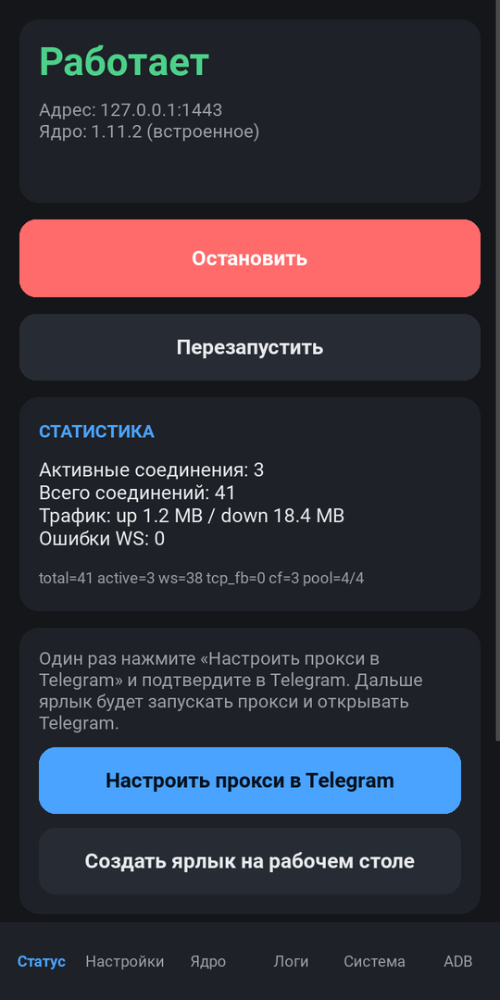
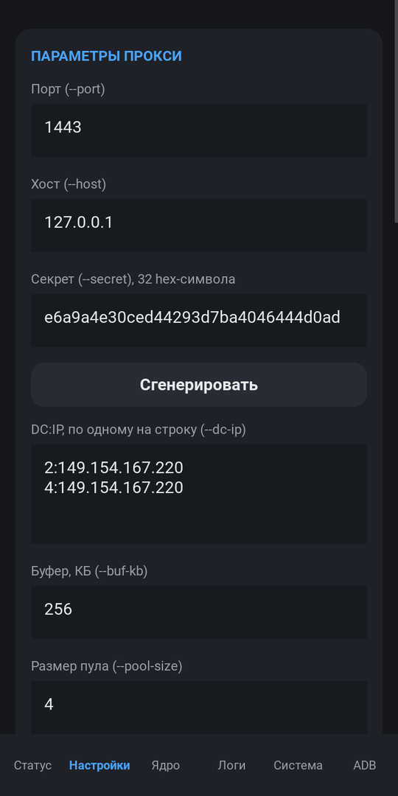
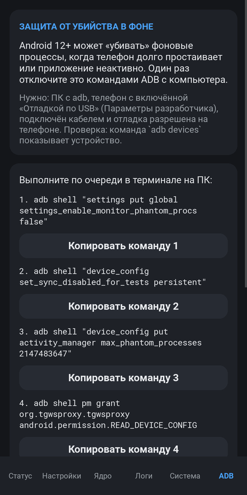
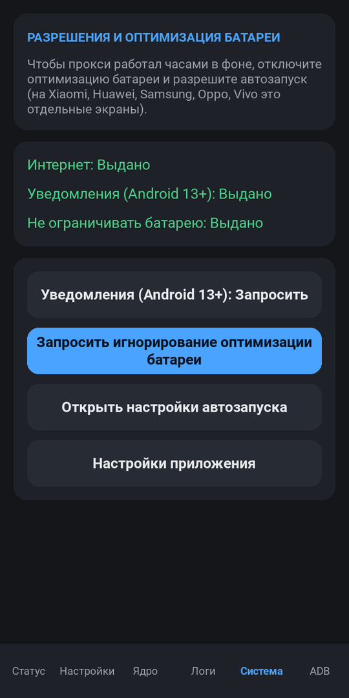
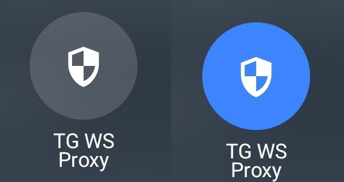
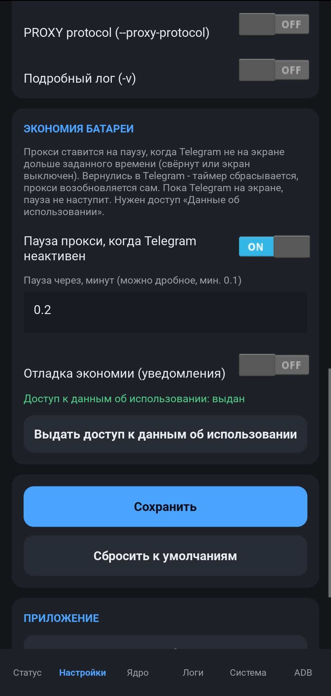
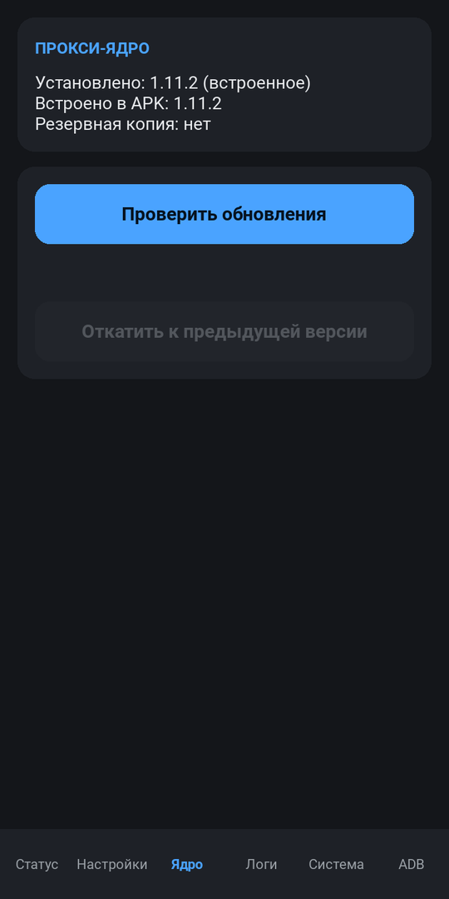
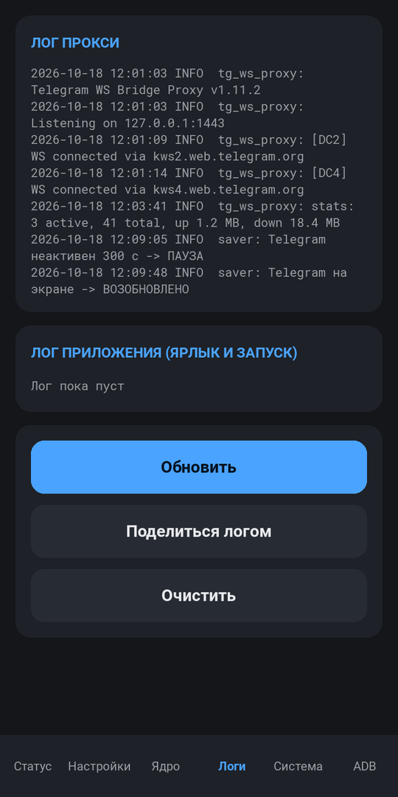

# TG WS Proxy Launcher

**Android-приложение, которое запускает локальный прокси для Telegram прямо на телефоне** и управляет им:
одной кнопкой, ярлыком на рабочем столе или плиткой в шторке. Основано на
[Flowseal/tg-ws-proxy](https://github.com/Flowseal/tg-ws-proxy) (MTProto → WebSocket), ядро v1.11.2.

Русский | [English](README.en.md)

<p align="center">
  
  
  
</p>

---

## ⚠️ Не грузятся фото и медиа? Сделайте это в первую очередь

Если текст и сообщения работают, а **фотографии/видео не грузятся**, оставьте в списке `DC:IP` только одну строку:

1. Откройте приложение → вкладка **Настройки** → поле **«DC:IP, по одному на строку (--dc-ip)»**.
2. **Удалите все строки** и оставьте ровно одну:
   ```
   4:149.154.167.220
   ```
3. Нажмите **Сохранить**.
4. Вкладка **Статус** → **Перезапустить** (или Остановить → Запустить).

Если после этого стало хуже, нажмите «Сбросить к умолчанию» на вкладке «Настройки» и верните исходный список.

---

## Содержание
- [Возможности](#возможности)
- [Установка](#установка)
- [Первый запуск — по шагам](#первый-запуск--по-шагам)
- [Ярлык «Telegram + прокси»](#ярлык-telegram--прокси)
- [Плитка в шторке](#плитка-в-шторке-быстрые-настройки)
- [Экономия батареи](#экономия-батареи)
- [Защита от убийства в фоне (ADB)](#защита-от-убийства-в-фоне-adb)
- [Справочник настроек](#справочник-настроек)
- [Обновление ядра прокси](#обновление-ядра-прокси)
- [Проблемы и решения](#проблемы-и-решения)
- [Сборка из исходников](#сборка-из-исходников)
- [Лицензия и благодарности](#лицензия-и-благодарности)

## Возможности

- Прокси работает как **фоновый сервис** с уведомлением, переживает закрытие приложения.
- **Все параметры** ядра (`--port`, `--dc-ip`, `--secret`, Cloudflare-домены, fake-TLS и т.д.) настраиваются в интерфейсе с проверкой ввода.
- Кнопка **«Настроить прокси в Telegram»** — готовая ссылка `tg://proxy`, подтверждаете один раз.
- **Ярлык на рабочем столе**: один тап поднимает прокси и открывает Telegram.
- **Плитка в шторке** (как Wi-Fi или Bluetooth): горит — прокси включён, не горит — выключен.
- **Режим экономии батареи**: прокси ставится на паузу, когда Telegram не на экране, и сам возобновляется при возврате.
- **Обновление ядра с GitHub** без переустановки APK; при проблемах — автоматический откат.
- Вкладка **ADB**: гайд и проверка, отключена ли «убивалка» фоновых процессов Android.
- Логи прокси и приложения, русский и английский язык, светлая и тёмная тема.

## Установка

1. Скачайте APK из раздела **[Releases](../../releases)** этого репозитория (или соберите сами — см. [BUILD.md](docs/BUILD.md)).
2. Скопируйте файл на телефон и откройте его. Если Android спросит, разрешите установку из этого источника.
3. Требуется **Android 8.0 (API 26) или новее**, архитектура arm64 или armv7.

## Первый запуск — по шагам

### 1. Разрешения (вкладка «Система»)



Откройте вкладку **Система** и выдайте:

- **Уведомления** (Android 13+) — без них уведомление сервиса не показывается.
- **Не ограничивать батарею** — кнопка «Запросить игнорирование оптимизации батареи». **Не пропускайте:** иначе система может остановить прокси в фоне.
- **Автозапуск / работа в фоне** — кнопка «Открыть настройки автозапуска». На Xiaomi, Huawei, Samsung, Oppo, Vivo и др. разрешите автозапуск и фоновую работу для TG WS Proxy.

<br clear="right">

### 2. Запуск прокси (вкладка «Статус»)

Нажмите **Запустить**. Статус сменится на **«Работает»**, в шторке появится уведомление сервиса.
На экране видны адрес (`127.0.0.1:1443`), версия ядра и статистика соединений.

### 3. Добавьте прокси в Telegram (один раз)

Нажмите **«Настроить прокси в Telegram»** → в Telegram подтвердите добавление прокси
(сервер `127.0.0.1`, порт `1443`). Проверить: *Telegram → Настройки → Данные и память → Прокси* — статус «подключено».

### 4. Сделайте ярлык (по желанию)

Нажмите **«Создать ярлык на рабочем столе»** и подтвердите в системном окне. См. следующий раздел.

## Ярлык «Telegram + прокси»

Тап по ярлыку: если прокси не запущен — он запускается, затем открывается Telegram.
Работает и когда приложение полностью закрыто. Если Telegram не установлен, приложение предложит открыть магазин.

> Ярлык создаётся системным диалогом Android. На некоторых лаунчерах (отдельные оболочки Xiaomi/Huawei) закрепление
> ярлыков может быть выключено — тогда включите разрешение «Ярлыки на рабочем столе» в настройках приложения.

## Плитка в шторке (быстрые настройки)



Плитка включает и выключает **всё приложение целиком** (сервис, режим экономии и остальное), а не просто сокет.

1. Вкладка **Статус** → **«Добавить плитку в шторку»**. На Android 13+ появится системный диалог — подтвердите.
   На более старых версиях: потяните шторку вниз → значок «карандаш» (изменить) → перетащите плитку **TG WS Proxy** в активные.
2. Тап по плитке: **горит** — прокси работает (или стоит на паузе экономии), **не горит** — выключен.
   Пока шторка открыта, состояние обновляется раз в секунду, поэтому плитка всегда совпадает с приложением.
3. Если приложение ни разу не настраивали или Android не разрешил запуск из плитки, плитка просто откроет приложение.

## Экономия батареи

Постоянно работающий прокси расходует батарею. Режим экономии **ставит прокси на паузу, когда Telegram не на экране**,
и возвращает его, как только вы открыли Telegram.



**Включение:** Настройки → блок «Экономия батареи» → переключатель «Пауза прокси, когда Telegram неактивен».
Один раз выдайте доступ **«Данные об использовании»** (кнопка в том же блоке откроет нужный экран — найдите TG WS Proxy и включите).
Без этого доступа режим не работает, а прокси остаётся включённым.

**Как это работает:**
- Окно Telegram отслеживается точно, в том числе когда оно свёрнуто или экран выключен.
- Пауза наступает только после того, как Telegram **непрерывно** неактивен заданное время (по умолчанию 5 минут).
  Свернули на секунду — таймер сбросится. Читаете чат час — пауза не наступит.
- Заметная фоновая передача данных тоже откладывает паузу.
- На паузе сетевая часть остановлена (это и есть экономия), а сервис лёгкий и раз в ~1,5 с проверяет, не открыли ли Telegram.
  Открыли — прокси возобновляется сам за 1–2 секунды. Также возобновляет ярлык и кнопка «Возобновить» на экране «Статус».
- Пока прокси на паузе, фоновые push-уведомления Telegram могут не приходить, если вашему региону нужен прокси.

<br clear="right">

**Отладка:** переключатель «Отладка экономии (уведомления)» включает постоянное уведомление с живым состоянием
(Telegram на экране или нет, сколько секунд неактивен, сколько осталось до паузы) и отдельные уведомления на каждое событие
(ушёл с экрана / вернулся / ПАУЗА / ВОЗОБНОВЛЕНО). Для проверки поставьте таймаут 0,5–1 минуту.

## Защита от убийства в фоне (ADB)


Android 12+ может «убивать» фоновые процессы, когда телефон долго простаивает. Это отключается один раз командами ADB.
Вкладка **ADB** содержит краткий гайд, команды с кнопками «Копировать» и **проверку статуса**
(«Применено / Частично / Не применено / Не удалось определить»).

**Что нужно:** компьютер с установленным [adb (platform-tools)](https://developer.android.com/tools/releases/platform-tools),
телефон с включённой «Отладкой по USB» (Параметры разработчика), подключённый кабелем, отладка разрешена на телефоне.
`adb devices` должен показывать устройство.

**Выполните по очереди на ПК:**

```bash
adb shell "settings put global settings_enable_monitor_phantom_procs false"
adb shell "device_config set_sync_disabled_for_tests persistent"
adb shell "device_config put activity_manager max_phantom_processes 2147483647"
adb shell pm grant org.tgwsproxy.tgwsproxy android.permission.READ_DEVICE_CONFIG
```

Последняя команда нужна только для того, чтобы приложение могло **проверить** значение лимита.
Затем откройте вкладку ADB и нажмите «Проверить снова».

Настройки переживают перезагрузку, но обновление системы может их сбросить — тогда выполните команды заново.
На Android ниже 12 такого ограничения нет, и вкладка так и напишет.

<br clear="right">

## Справочник настроек

Вкладка **Настройки** (изменения сохраняются автоматически, неверные значения подсвечиваются и не применяются).

| Поле | Параметр ядра | Что делает |
|---|---|---|
| Порт | `--port` | Порт локального прокси, по умолчанию `1443`. Используйте порт выше 1024. |
| Хост | `--host` | Адрес прослушивания, по умолчанию `127.0.0.1` (доступен только на телефоне). |
| Секрет | `--secret` | 32 hex-символа. Кнопка «Сгенерировать» создаёт новый; после смены заново добавьте прокси в Telegram. |
| DC:IP | `--dc-ip` | Соответствие дата-центров Telegram и IP, по одной строке `DC:IP`. **Если не грузятся фото — оставьте только `4:149.154.167.220`** (см. начало README). |
| Буфер, КБ | `--buf-kb` | Размер буфера сокета (4–65536), по умолчанию 256. |
| Размер пула | `--pool-size` | Пул WebSocket-соединений на дата-центр (0–64), 0 отключает прямой WS. |
| CF-домены | `--cfproxy-domain` | Свои домены за Cloudflare для медиа и запасного канала, по одному на строку. |
| CF Worker-домены | `--cfproxy-worker-domain` | Домены Cloudflare Worker для запасного канала. |
| Отключить HTTP/2 для CF | `--no-h2` | Выключает HTTP/2-мультиплексирование для медиа через CF. |
| Отключить CF-прокси | `--no-cfproxy` | Полностью отключает запасной путь через Cloudflare. |
| Порт 80 для CF | `--no-secure` | Использовать порт 80 для соединений с CF. |
| Fake-TLS домен | `--fake-tls-domain` | Маскировка под TLS (ee-секрет) с указанным SNI-доменом. |
| Тестовые DC | `--force-test-dc` | Весь трафик на тестовые дата-центры Telegram. Обычно не нужно. |
| PROXY protocol | `--proxy-protocol` | Принимать заголовок PROXY protocol v1 (если стоит за nginx/haproxy). |
| Подробный лог | `-v` | Отладочный лог на вкладке «Логи». |

Блок «Приложение»: выбор Telegram-клиента (Авто / Telegram / Telegram X / Plus Messenger / NekoX / Nekogram / Forkgram), язык и тема.
Кнопка «Сбросить к умолчанию» возвращает только параметры прокси.

<p align="center">
  
  
</p>

## Обновление ядра прокси

Вкладка **Ядро** → «Проверить обновления» → «Обновить». Архив релиза скачивается по HTTPS и проверяется
(размер, безопасные пути, структура, синтаксис, наличие нужных библиотек в APK), затем активируется.
Предыдущая версия сохраняется; если новое ядро не запускается, сервис **откатывает** его автоматически.
Кнопка «Откатить к предыдущей версии» делает это вручную. Если новому ядру понадобятся новые библиотеки — потребуется свежий APK.

## Проблемы и решения

| Симптом | Что делать |
|---|---|
| **Не грузятся фото/видео** | Оставьте в `DC:IP` только `4:149.154.167.220` и перезапустите прокси (инструкция в самом начале этого README). |
| Статус «Ошибка: порт занят» | Другая программа использует порт. Смените порт в настройках и заново добавьте прокси в Telegram. |
| Прокси «умирает» через время в фоне | Выдайте исключение из оптимизации батареи и автозапуск (вкладка «Система»), выполните команды на вкладке ADB. |
| Ярлык не запускает прокси с первого раза | Обновитесь до последней версии; убедитесь, что выдано исключение из оптимизации батареи. |
| Режим экономии не срабатывает | Не выдан доступ «Данные об использовании». Включите «Отладку экономии» и смотрите уведомление. |
| Плитки нет в списке | Переустановите APK, затем используйте кнопку «Добавить плитку» или найдите её в режиме редактирования шторки. |
| Не удаётся проверить обновление ядра | Нет доступа к GitHub из вашей сети; сам прокси при этом работает. |
| Нужен лог для сообщения об ошибке | Вкладка «Логи» → «Поделиться логом». |

Ограничения: Android 12+ может запретить перезапуск убитого фонового сервиса (исключение из оптимизации батареи это снимает);
текст уведомления сервиса менять нельзя (создаётся системной библиотекой).

## Сборка из исходников

Подробно: **[docs/BUILD.md](docs/BUILD.md)** (GitHub Actions и ручная сборка на Linux/WSL).
Устройство проекта и тесты: [docs/DEVELOPMENT.md](docs/DEVELOPMENT.md). История изменений: [CHANGELOG.md](CHANGELOG.md).

## Лицензия и благодарности

- Код лаунчера — MIT, см. [LICENSE](LICENSE).
- Прокси-ядро — [Flowseal/tg-ws-proxy](https://github.com/Flowseal/tg-ws-proxy), лицензия MIT,
  текст в [THIRD_PARTY_LICENSES](THIRD_PARTY_LICENSES).
- Приложение собрано на [Kivy](https://kivy.org) и [python-for-android](https://github.com/kivy/python-for-android).
- Неофициальный проект, не связан с Telegram.
